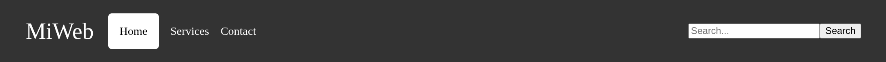
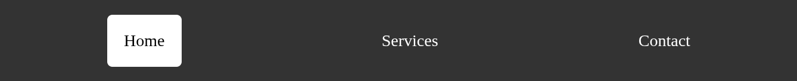
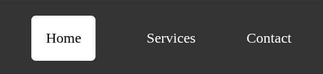

# Ariketa 03

Hurrengo goiburua egin Flex erabiliz:

- Koloreak: #333 eta zuria
- #nav padding: 1rem
- “active” dagoen esteka aldrebes (textua #333 eta background zuria)

Tamaina osoa

<768 tamaina

<768 tamaina eta mugikorrean ikustean

- Desktop-en guztia ikusten da (**0,75 puntu**):
  - #logo eta #menu ezkerraldean
  - #search: eskuinean jarri
  - goiko argazkian 
- Pantailaren tamaina < 768px denean:
  - #logo eta #search desagertzen dira. (**0,75 puntu**)
  - textuen artean: espazio berdina.
