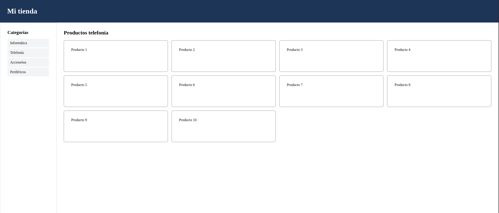
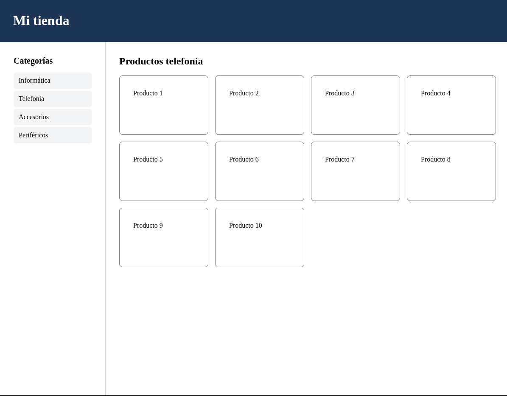
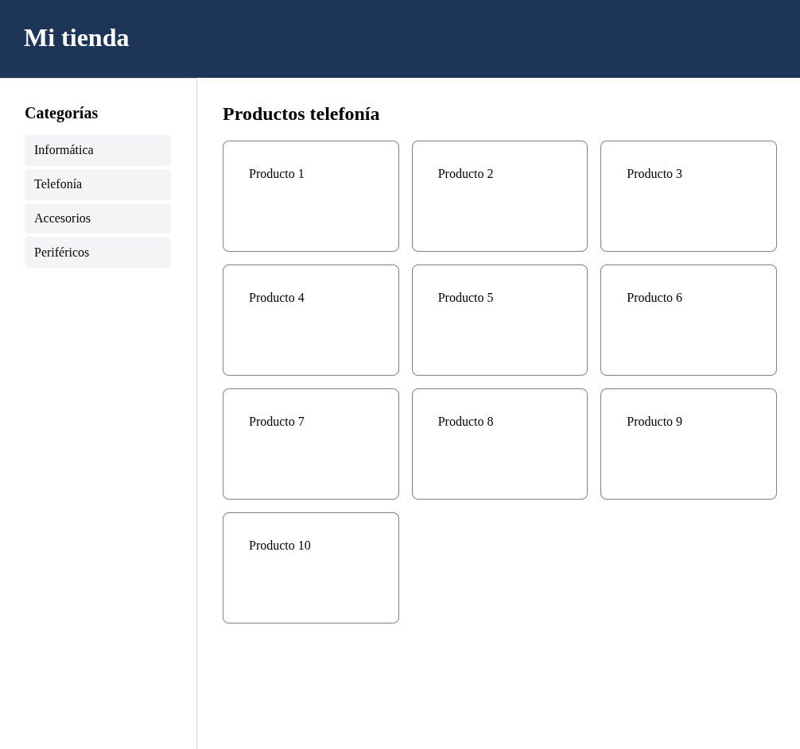
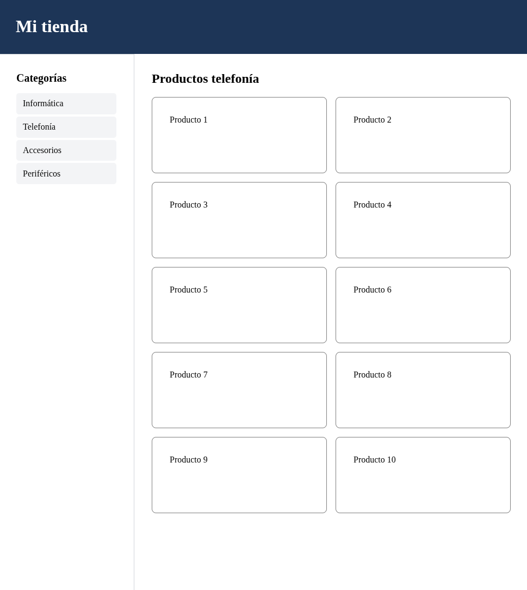
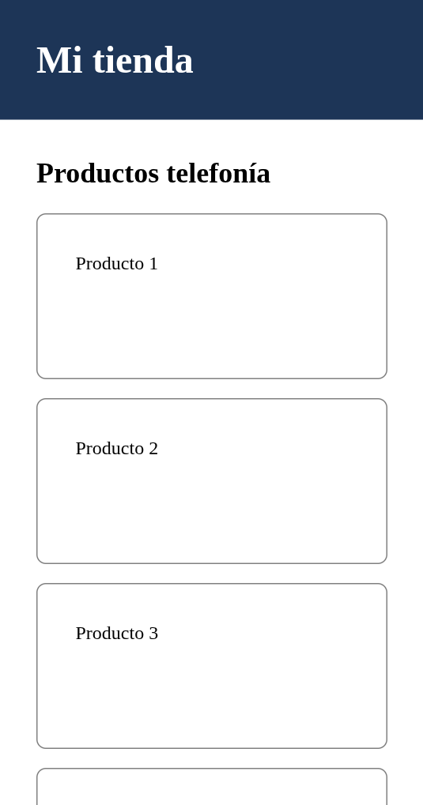

# Ariketa 04

Hurrengo webgunearen layout egin:

- “.layout”-en: Grid erabili (2 kolumnak)  (**1,5 puntu**)
  - “aside”-n tamaina 250px, bestea “main”-entzako.
  - “.productos”-en Grid erabili 4 kolumnekin. Gap: 1rem
- .producto bakoitzak: width gutxiena: 210px, altuera 140px, padding 2rem
- tamaina < 1200px :  .productos-en  3 kolumna erabili  (**0,25 puntu**)
- tamaina < 990px :  .productos-en 2 kolumna erabili  (**0,25 puntu**)
- tamaina < 768px: .productos-en 1 kolumna erabili.   (**0,5 puntu**)
  - “.layout”: Grid-en template kolumna bakarra.
  - “.categorias” kentzen da 

